# Vector and Superfactorial mount experiment — 0.32.0

Vector uses one centred cannon, with a separate sprite size and muzzle position for Alpha, Beta and Gamma. Its private projectile combines the former paired guns’ damage. Range, reverse damage falloff, charge duration and reload stay unchanged. A single projectile can respond differently to flat armour than two smaller hits; this remains a starting balance for playtesting.

Superfactorial uses three compact guns. Damage per round, ±24° spread, armour penetration and the three-second spin-up remain unchanged. Each barrel uses a 45-tick cold interval rather than 30, preserving the original aggregate 4-to-60 rounds per second at neutral Fire Rate. Each gun retains native recoil and heat; live spin decoration now draws after both native and painted gun rendering.

The six pixel sprites are generated once through native MultiPacker APIs, using the existing hull/accent palette shader. They introduce no unit or bullet IDs, per-player textures, or shared vanilla weapon mutations. Preview framing includes the custom barrel bounds.

Native neutral hull snapshots can rebuild weapon mounts when their number differs. UnitLoadouts retains the active mounts per tracked unit and restores them before rebinding the private view, preserving charge/reload, spin, recoil and sounds. Weapon swaps still remove obsolete mount callbacks and effects through the existing bind lifecycle.

Validation: full v160.2 native regression suite; explicit barrel-count, output, isolation and repeated neutral-snapshot checks; actual v160.7 renderer showing idle/charge/firing on all six combinations; two actual v160.7 host/observer processes exercising all six live layouts across repeated snapshots. Network validation used localhost.

For the visual comparison, Alpha/Beta/Gamma run from left to right, Vector on top and Superfactorial below.

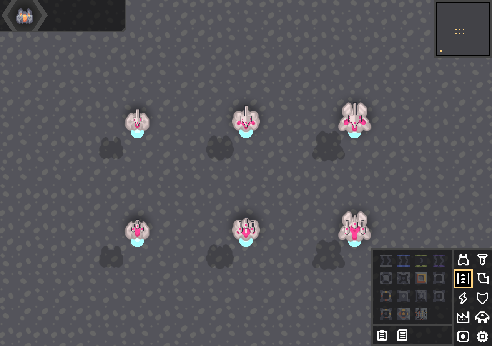

## 0.32.1 — vanilla artwork and four-gun pairs

Replaced the prototype artwork with each tier's native gun sprite, mirrored and resized with nearest-neighbour sampling. Outlines use Arc's native outline helper and the ship's outline colour; casing and accent pixels continue through the existing cosmetic shader.

Vector now uses a larger 23×44 / 29×56 / 35×68 sprite and mounts 3 / 4.25 / 5.5 world units ahead of the ship centre on Alpha / Beta / Gamma. Its combined damage, charge, reload and accuracy remain unchanged.

Superfactorial now has four smaller guns, arranged as a symmetric outer pair and a forward inner pair. One mount's per-unit transient state schedules alternating two-round volleys; native Weapon still creates each shot, recoil and sound. The neutral total cadence remains 4 to 60 rounds per second over the same three-second spin-up, with the original damage per round and penetration curve. Fire Rate modifies the shared volley clock. Releasing fire, disarm and docking reset the pattern.

Regression checks observe the actual shots every frame on all three tiers, requiring exactly two guns per volley, matching symmetric pairs, alternating outer/inner order and 60 rounds in a full-spin second. The native visual check and host/observer check exercise all six tier/weapon layouts.

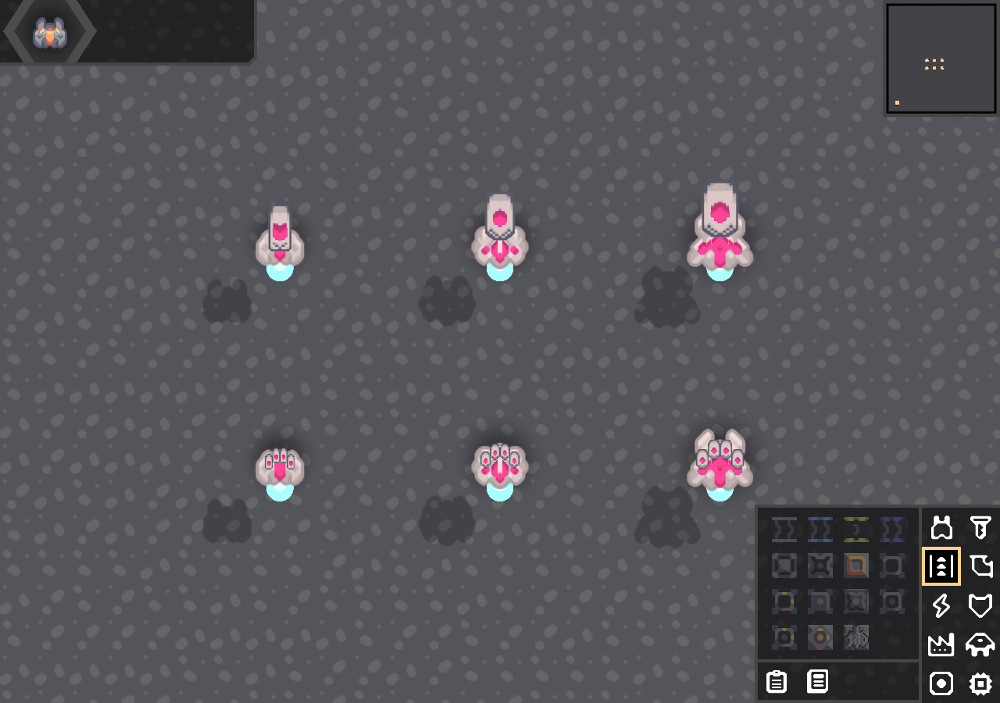

## 0.32.2 — complete vanilla gun shapes

Removed the mirrored-half reconstruction and independent width/height scaling. Vector now joins two complete native gun sprites in their normal left/right orientations, overlapping by one third of the source width to form one central gun. The result is scaled uniformly by 1.4 / 1.5 / 1.6 on Alpha / Beta / Gamma and retains its forward mounting position.

Superfactorial uses the complete original sprite at 80% size, with normal mirrored orientations on the ship's left and right. Its four-gun placement, alternating outer/inner pairs, spin-up, damage and total cadence are unchanged. Muzzle offsets now scale from the native gun definition, matching the artwork's proportions.

All gun detail pixels come from the original native sprite; the native Arc outline helper supplies the surrounding outline. The full native gameplay suite and six-layout desktop visual/firing check pass.

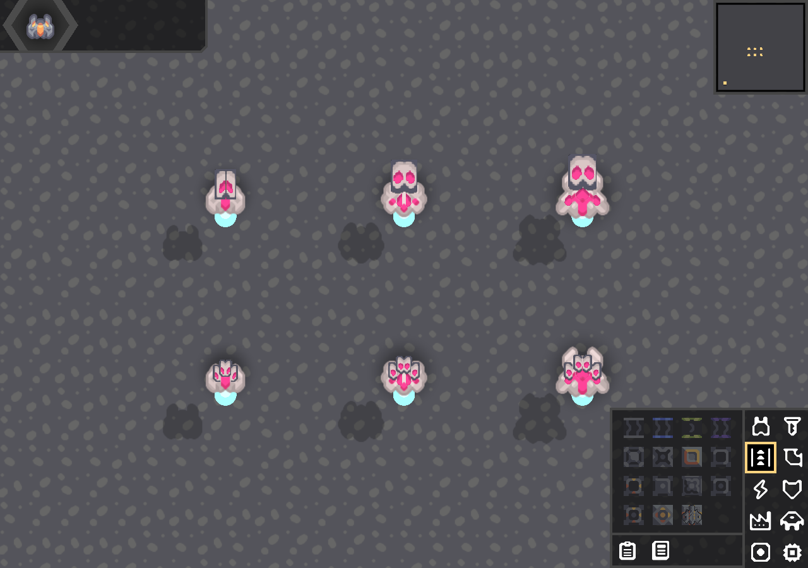

## 0.32.3 — lighter presentation

Reversed Superfactorial's left/right sprite orientations. Removed the generated outline sprites from both experimental weapons and removed the continuous Superfactorial firing-ring overlay and its unused drawing helpers. Ordinary shot flashes, projectiles and recoil remain. Vector's uniform artwork scale and corresponding native muzzle offset are reduced by 20%; its forward mount position is retained. Damage, cadence, spin-up and alternating-pair behaviour are unchanged.

The full native gameplay suite passes. The desktop preview checks all six layouts, explicitly rejects added outline regions, and captures idle and firing states.

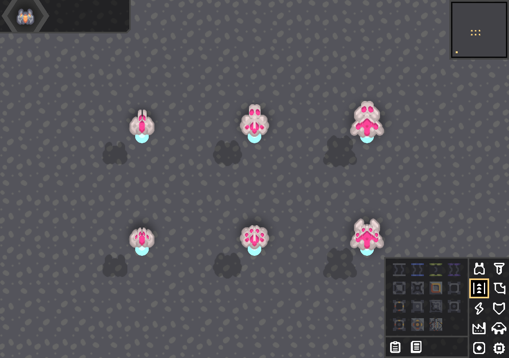

## 0.32.4 — tighter Vector join

Slightly increased the overlap between Vector's two intact vanilla gun sprites, narrowing the composite without stretching either gun. Alpha uses extra overlap to close its central gap. Scale, height, forward mount position and weapon behaviour are unchanged. Superfactorial is unchanged. Build and the six-layout native desktop preview pass.

## 0.32.5 — symmetric Vector and Flux nozzle

Vector now mirrors the finished composite before and after nearest-neighbour scaling, preventing overlap priority and rounding from producing different left/right halves. Beta and Gamma use progressively greater overlap to narrow their guns. A native atlas check compares every corresponding final pixel on Alpha, Beta and Gamma.

Flux retains its vanilla rear gun body and tapers the front half to a thin nozzle using the source palette. Its existing native mount positions, mirrored orientations and zero recoil are retained. Flame lifetime increases by 10% and native calculated range rises from 60.3 to 66.33 world units (about 7.54 to 8.29 tiles); the editor uses that actual range. The visible flame cone narrows from ±10 to ±8 degrees. Actual projectiles already have zero inaccuracy, which remains unchanged. Damage, Burning, costs, reload and air/ground collision are unchanged; vanilla Scorch ammo is untouched.

The full v160.2 gameplay suite passes, including actual flame flight beyond the old reach, tier damage, range preview and native-ammo isolation. The v160.7 desktop preview exercises all nine tier/weapon layouts and verifies exact Vector pixel symmetry. The existing Superfactorial random-spread test now samples additional actual rounds if its first short window misses the outer spread.

Rows in the preview are Vector, Superfactorial and Flux; columns are Alpha, Beta and Gamma.

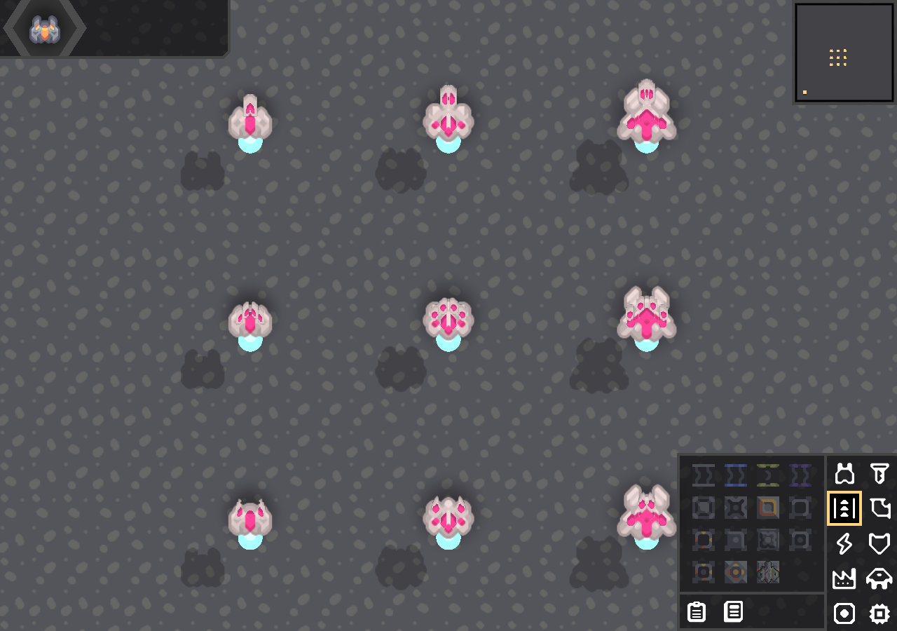

## 0.32.6 — Alpha nozzle alignment and Vector placement

Alpha Flux uses centred sampling and paired width steps through its taper so successive rows do not shift the nozzle centre by a pixel. Beta/Gamma Flux artwork and flame tuning are unchanged. Vector mounts move back 0.75 world units on every tier, preserving sprite size and symmetry. Build and native nine-layout visual/firing checks pass.

## 0.32.7 — Alpha Vector rear-cap trim

Removed the grey cap below Alpha Vector's last native accent row, keeping its pink markings, sprite canvas, mount and recoil transforms intact. Beta/Gamma and other weapons are unchanged. Build, final pixel symmetry and nine-layout desktop checks pass; an additional native capture checks the first shot at full recoil. Converge remains at the design-discussion stage.

## 0.32.8 — Alpha accent contour and Converge pods

Alpha Vector's rear is trimmed per column to the last native accent pixel. Columns with no accent lose the rear casing below the start of the accent region, removing the side overhangs and centre fill left by the earlier flat cap trim. The native pink-mask pixels are preserved exactly; the front housing, mount position and recoil remain intact.

Converge now has two compact launcher pods built from the original gun artwork: the exposed front barrel quarter is cropped, with a small uniform tier-scaled enlargement retaining the native rear housing and colours. The pods sit slightly closer to and farther back along the hull. Their muzzle offsets follow the shorter barrels and they have a brief native recoil kick. Existing compact launch flashes are retained. No extra outlines or continuous effects are added. Shot count, damage, reload, homing, range and three-bomblet split behaviour are unchanged.

Full v160.2 gameplay checks pass, including Converge's existing hit/miss/split and loadout tests. The v160.7 desktop fixture exercises twelve tier/weapon layouts with real firing/recoil, checks Vector pixel symmetry and verifies Alpha accent-pixel retention. Preview rows: Vector, Superfactorial, Flux, Converge; columns: Alpha, Beta, Gamma.

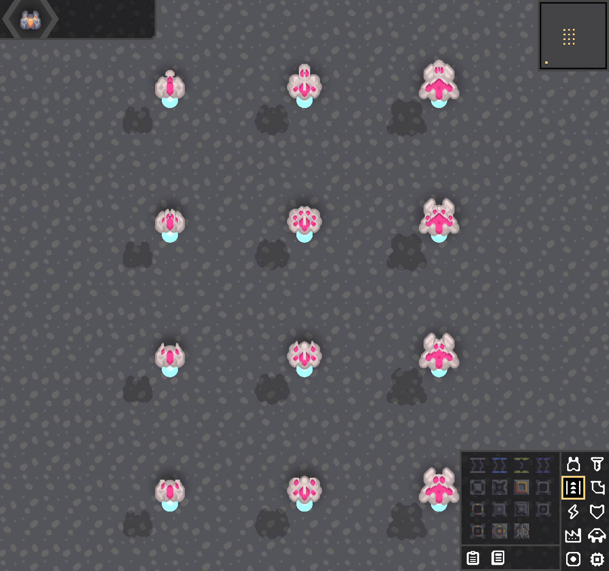

## 0.32.9 — restore Alpha casing, shade Converge tips, investigate crash

Reverted the aggressive per-column Alpha Vector mask: its surrounding vanilla casing is restored, retaining only the shallow flat trim after the last accent row. Converge's muzzle has a two-pixel dark/medium-grey lip using the native gun palette and preserving source alpha. No firing mechanics changed.

The reported crash occurred while firing Alpha Vector and watching recoil. The current Steam game log and Steam console did not contain a matching exception; available older crash reports predate this build. No crash fix is claimed. A focused desktop fixture fires Alpha repeatedly after a console-style tier change, with movement/aim, charge, recoil and steam reload effects. Original 0.32.8 passed 12 shots on Intel/Java 25 with both mods. The repaired build passed 12 shots and 1198 reload frames on the user's NVIDIA RTX 4050 / driver 615.78.08, installed Java 25.0.1 and both mods. This direct desktop test runs in an isolated world without the Steam wrapper/overlay. The original crash remains unreproduced.

The full v160.2 gameplay suite and v160.7 twelve-layout native visual/firing checks also pass, including exact Vector pixel symmetry.

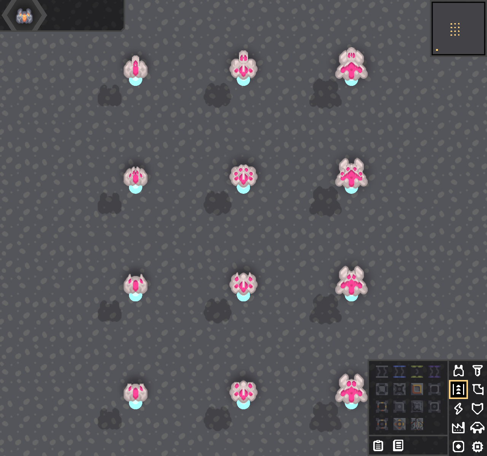

## 0.32.10 — recessed Alpha Vector and rounded Gamma pods

Alpha Vector retains only native accent pixels from the start of its pink rear marking backwards, removing all non-accent rear pixels while preserving every accent pixel. Its mount moves back one additional world unit; Beta/Gamma Vector positions are unchanged. Gamma Converge's outboard corners have a subtle two-pixel contour trim, with native mount mirroring selecting the correct outside edge on each pod. Its dark muzzle lips remain. Other tiers and weapon stats are unchanged.

Build and the twelve-layout native desktop firing/recoil preview pass. Final Vector symmetry and Alpha accent retention are verified, along with complete removal of non-accent pixels in the rear region.

## 0.32.11 — Alpha Vector front collar

Restored the native grey collar around the front/widest part of Alpha Vector's pink marking. Only the narrowing rear section retains the accent-only trim. Every accent pixel and every pixel in the previously accepted rear section are unchanged, as is the recessed mount position. Other weapons are unchanged; Caustic is still at the design-discussion stage. Build, twelve-layout native firing/recoil preview and Vector pixel symmetry checks pass.

## 0.32.12 — Caustic forks and Alpha accent flare

Caustic uses two forked emitters formed by opening the front third of the original vanilla gun sprite. The original rear housing, shading and cosmetic palette are retained. Existing muzzle glow sits in the fork opening, with the beam origin moved 0.25 world units inward. Native paired positions, zero recoil, continuous firing, beam range/damage, corrosion, sounds and existing beam effects are retained. No extra ring overlay or content IDs are introduced.

Alpha Vector's accent flares across its last three base rows, replacing a small amount of existing grey casing with copied native accent-edge colours. Original accent pixels, accepted rear trim and mount position are unchanged. The final flare adds twelve accent pixels and preserves exact left/right symmetry.

The full native gameplay suite passes, including held Caustic firing, corrosion, movement, aim interpolation and cleanup. Native desktop checks exercise fifteen tier/weapon combinations through firing/recoil and verify exact Vector symmetry. After reviewing the first preview, the final art opens the fork slightly wider and blends the Alpha flare through three rows; the final native renderer check also passes. Preview rows: Vector, Superfactorial, Flux, Converge and Caustic; columns: Alpha, Beta, Gamma.

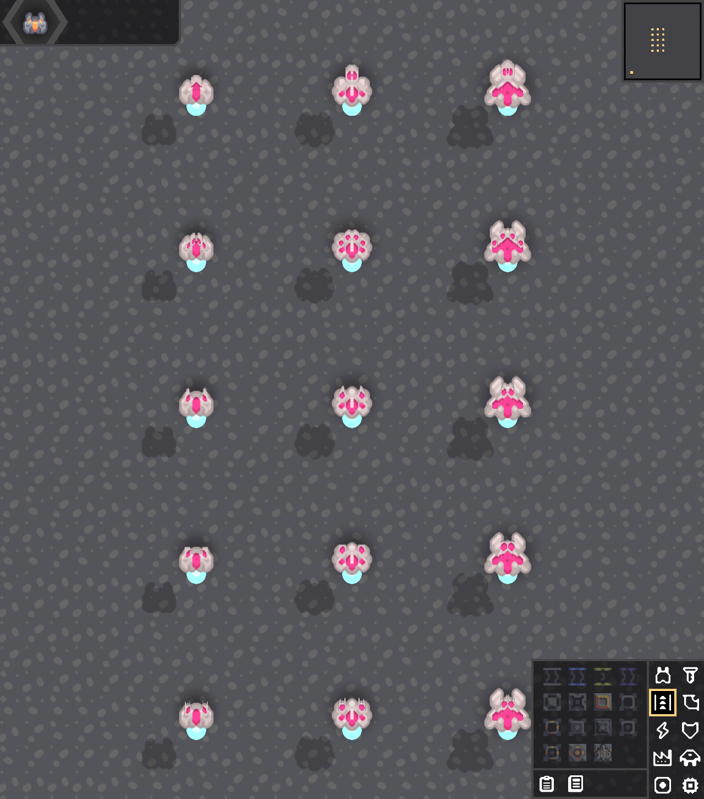

## 0.32.13 — lighter Alpha segment and softer Caustic fork roots

Reverted the widening of Alpha Vector's dark cap. The original cap and grey collar are restored exactly, as verified against 0.32.11 pixels. Only the lighter accent segment beneath the cap widens by one pixel per side across three rows, using its original bright accent colours. Rear trim, mount position and original accent pixels are preserved.

Caustic retains its forked design with a stepped round at the inside root of each opening, replacing the abrupt square-cut inner corners. Other artwork and all weapon behaviour are unchanged. Build, fifteen-layout native firing/recoil preview and final Vector pixel-symmetry checks pass.

## 0.32.14 — Involution cradles and Asymptote accelerators

Involution uses compact vanilla gun housings with a shallow V-shaped opening. Each gun shows a small engine-coloured seated blade that disappears on launch, stays empty for the first 15% of its reload, then smoothly reforms. The overlay reads native mount reload directly and works in both default and recoloured rendering. Native alternating cadence, flight guidance, retrace, catch and return damage are preserved.

Asymptote retains its stock rear housing with a slightly extended and narrowed front barrel and recessed centre rail. Its existing full-reload electricity/crackle, damage, range and fire rate are retained. No new content IDs, packets or persistent state are needed.

Validation: complete native gameplay suite on API 160.2; actual launch/half-reload/readiness checks across all three Involution tiers; desktop 160.7 native rendering/firing/recoil check for twelve default/painted tier combinations. Existing Involution alternating cadence and return-flight tests also pass.

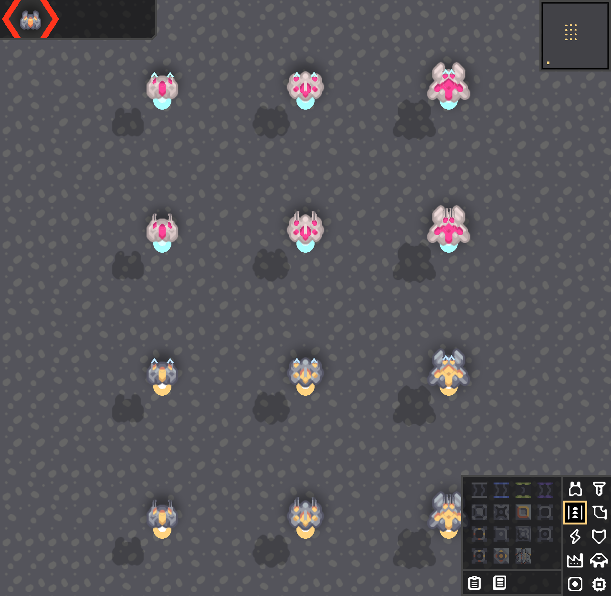

## 0.32.15 — lighter Asymptote rail

Changed only the recessed centre rail from dark grey to mid-grey, reducing its contrast and allowing it to follow the hull paint shading. Involution is unchanged. Desktop build and twelve default/painted tier mount rendering/firing checks pass. Installed locally with a backup.

## 0.32.16 — central Recurrence conductor and Eigen launch tube

Recurrence has one central tapered conductor, assembled from joined vanilla gun housings. It replaces the former paired mounts with one discharge at the same reload rate. Each discharge combines the former pair's nominal damage and armour deduction; the first-hit preview reflects that combined damage. The three chain jumps and their 25% falloff remain unchanged. Combining simultaneous hits can change target selection when the former first shot would have killed a target before the second shot.

Eigen uses one broad central launch tube with a recessed opening, retaining the vanilla rear housing and palette. Its existing service launches all nine drones through the physical muzzle with recoil and heat; capacity, deployment/replacement timing, drone damage, steering and energy are unchanged. Legacy saved launch indices remain readable through the existing modulo selection. Neither design adds content IDs, outlines or packets. Involution and Asymptote are unchanged.

Validation: complete native gameplay suite on 160.2, including Recurrence chain-hit damage, central mount geometry/damage/armour deduction, nine manual Eigen launches, disk/join persistence and repeated neutral-hull snapshot repair. Native desktop 160.7 preview exercised twelve default/painted tier combinations through firing and recoil, with atlas region checks. The earlier native graphics presentation freeze remains unresolved; this update makes no claim to fix it.

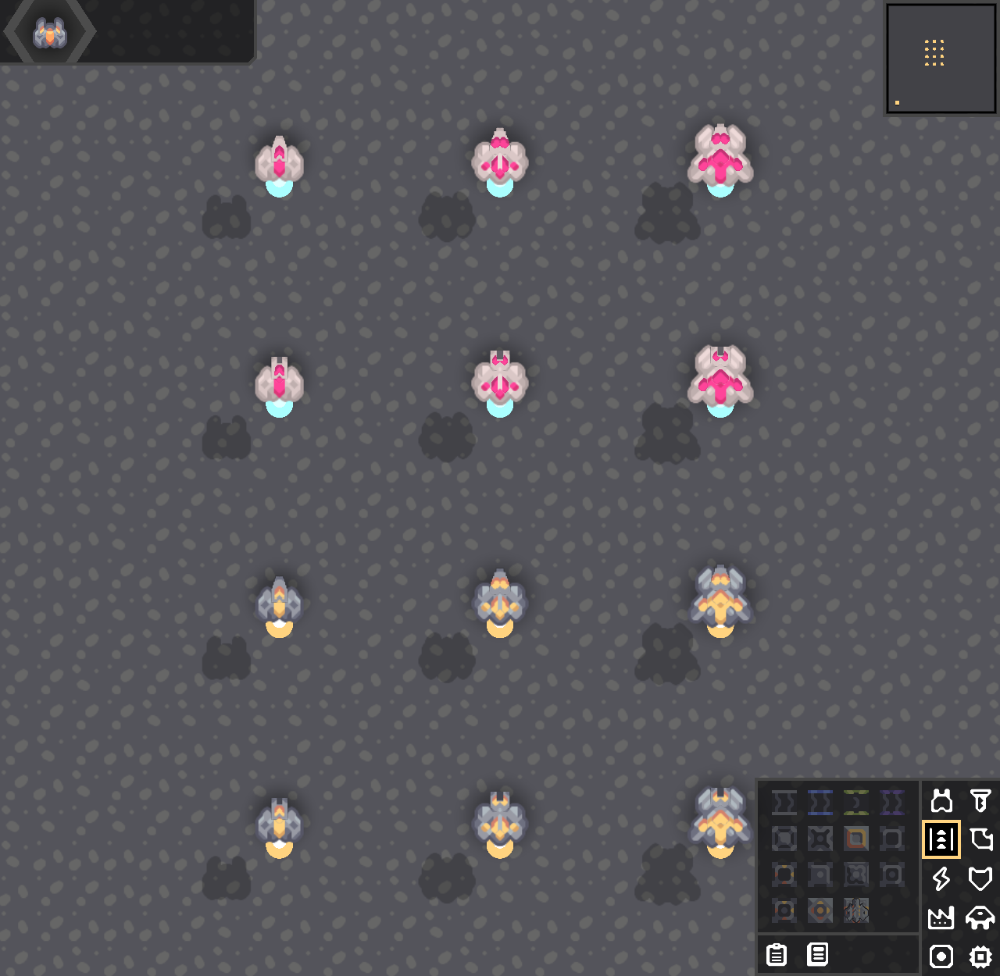

## 0.32.17 — accelerator-style Recurrence and flared Eigen tube

Recurrence now reuses Asymptote's native barrel extension and lighter centre-rail treatment as a single enlarged central prong (1.55 scale). The former joined/tapered conductor artwork is removed. Its muzzle follows the extended barrel.

Eigen's mouth expands outward toward the front, with paired contour steps and a recessed bore. The flare samples the original housing rows and preserves the vanilla palette, with no added outer outline. Its single launcher position and deployment timing are retained. Damage, reload and drone behaviour are unchanged from 0.32.16.

Validation: desktop build and native 160.7 rendering/firing/recoil across twelve default/painted tier combinations pass. The isolated preview uses the project's complete 160.7 runtime because the current installed Steam archive no longer contains the native libraries required by the standalone harness. No changes were made to the game installation to work around that harness limitation.

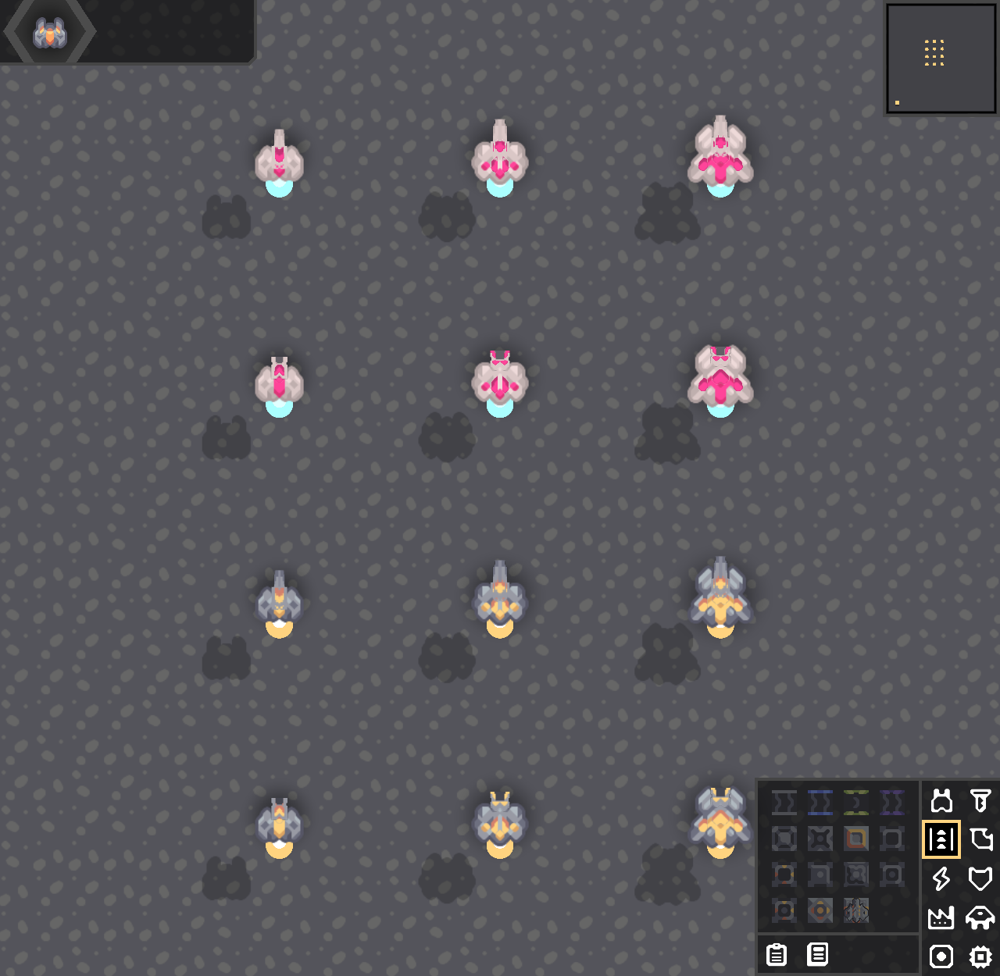

## 0.32.18 — Eigen engine insert and slim Recurrence housing

Eigen's formerly dark bore/tip now has a separate engine-coloured atlas insert, with a gentle 234–250/255 shade ramp. The insert is drawn after both native and painted gun rendering, following the same mount position and recoil. It uses the ship's selected engine colour, or the native team-colour fallback when engineColor is null. Hull and accent paint do not affect the insert. The flared mouth and rim remain.

Recurrence keeps its enlarged Asymptote-style prong. Its rear casing is cut to a one-pixel collar around the native accent marking, with a narrow tapered tail in place of the rectangular base. This exposes the ship's surrounding accents without moving the muzzle.

Validation: desktop build and native 160.7 rendering/firing/recoil across all twelve default/painted tier combinations pass. The first isolated render caught a null vanilla engineColor; the final version follows the native UnitEngine team-colour fallback and passes that same default-palette case. No weapon damage, firing cadence, drone state or persistence changes.

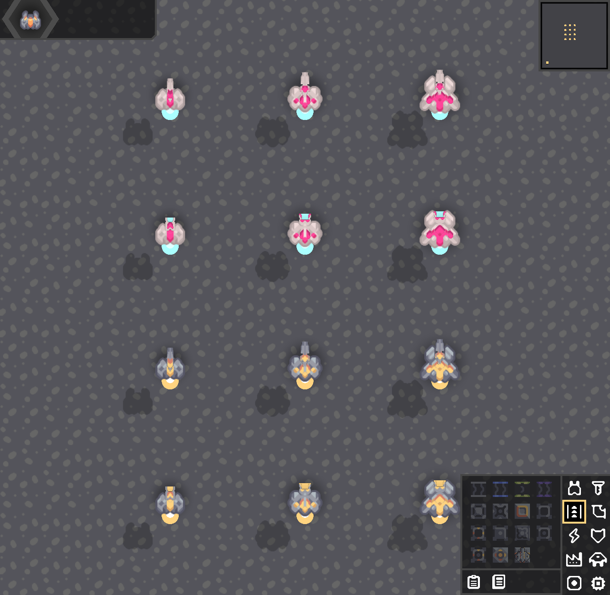

## 0.32.23 — Recurrence and utility visual polish

Recurrence has narrower front shoulders and centered odd-width rounding across all tiers. Its accent collar, single enlarged prong, muzzle position, damage and cadence remain unchanged. Divergence hides its weapon sprites, heat overlays and weapon outlines in both native and painted views; its hull pulse and cooldown are unchanged. Invariant projection endpoints now stop 0.6 world units from the shield band instead of 3, with small pulsing emitter halos and pale cores. The existing wobble and shield collision polygon are unchanged. Operator remains unchanged pending a design choice.

Validation: full native server smoke suite passes, including the shield connection test tightened from six units to one. Isolated Mindustry 160.7 NVIDIA desktop rendering checks all eighteen default/painted tier/weapon combinations, checks exact Recurrence pixel symmetry, and exercises Recurrence firing/recoil plus active utility rendering. No multiplayer session was run for this visual pass. The freeze recorder remains installed; this patch does not claim to fix the rare graphics freeze.

## 0.32.24 — rounded Invariant ends and darker Recurrence details

Invariant rounds the four corners of the band ends with short quadratic curves. Rendering uses Arc's concave polygon triangulator, and absorption uses the same rounded polygon. The open interior and rear opening remain. Projection links add two animated transverse waves, tapered to zero at both attachment points, while retaining the native shield ripple displacement.

Divergence was already using volume 1.0; its shootArc playback pitch is raised from 0.6 to 0.95, on both authority-local and network sound calls. No loudness normalization or audio listening test was performed. Recurrence's pale accent collar/highlight pixels now use native dark orange, which maps to the selected dark accent colour. Its tip neutrals blend 40% toward native rear-hull grey. Alpha/Beta/Gamma sprite symmetry is verified.

Validation: complete native server smoke suite passes, including front/side/interior/rear shield coverage, swept absorption and projectile-to-shield attachment checks. The isolated NVIDIA Mindustry 160.7 desktop preview passes across eighteen default/painted weapon/tier combinations; active shield and revised sprite screenshots were inspected. Multiplayer was not run for this visual/audio adjustment.

## 0.32.25 — rear-only Recurrence correction and fully rounded shield caps

Restored Recurrence's original native accent rows, including highlights. Only existing nontransparent rear housing pixels behind the last native accent row now receive the dark accent palette; the slight tip darkening remains. Pixel comparison against 0.32.23 confirms original accent rows and every alpha value are preserved across Alpha/Beta/Gamma.

Invariant replaces the former small corner bevels with full semicircular end caps, flattened with the same ellipse transform as the band. Rendering, break outlines and absorption share the new outline. Wavy projection links use a faint wider carrier and travelling scan bands for a holographic appearance.

Validation: full smoke suite passes; NVIDIA native 160.7 desktop preview passes across eighteen tier/weapon/palette combinations. Idle sprite, active shield and projection-link screenshots inspected. No multiplayer session was run for this pass.

## 0.32.26 — final Recurrence collar and tip shading

Remaining neutral collar pixels alongside the native accent rows now use the dark accent palette. Existing native accent markings and all sprite alpha values are preserved across all three tiers. Barrel-tip neutrals now blend 70% toward native rear-hull grey instead of 40%. Invariant code is byte-identical to the previously installed build.

Validation: full smoke suite and native 160.7 NVIDIA visual preview pass. Idle screenshot inspected; packed sprites compared against 0.32.25 for accent and silhouette preservation.

## 0.32.27 — restored barrel face and rounded accent collar

Removed the broad tip darkening: all pixels ahead of the first native accent row now exactly match the 0.32.23 barrel, preserving its lighter face and native dark edge shading. The first four rows of the accent collar have paired grey shoulder steps (two pixels then one), softening the pink-to-grey transition while preserving the silhouette. Rear/collar recolouring remains elsewhere.

Validation: desktop build and native 160.7 NVIDIA preview pass across all tiers and default/painted views. Exact packed-pixel comparison confirms the restored barrel face and unchanged alpha across Alpha/Beta/Gamma. Idle screenshot inspected. Gameplay smoke suite was not repeated for this sprite-only change. Invariant bytecode is identical to the previous installed build.
