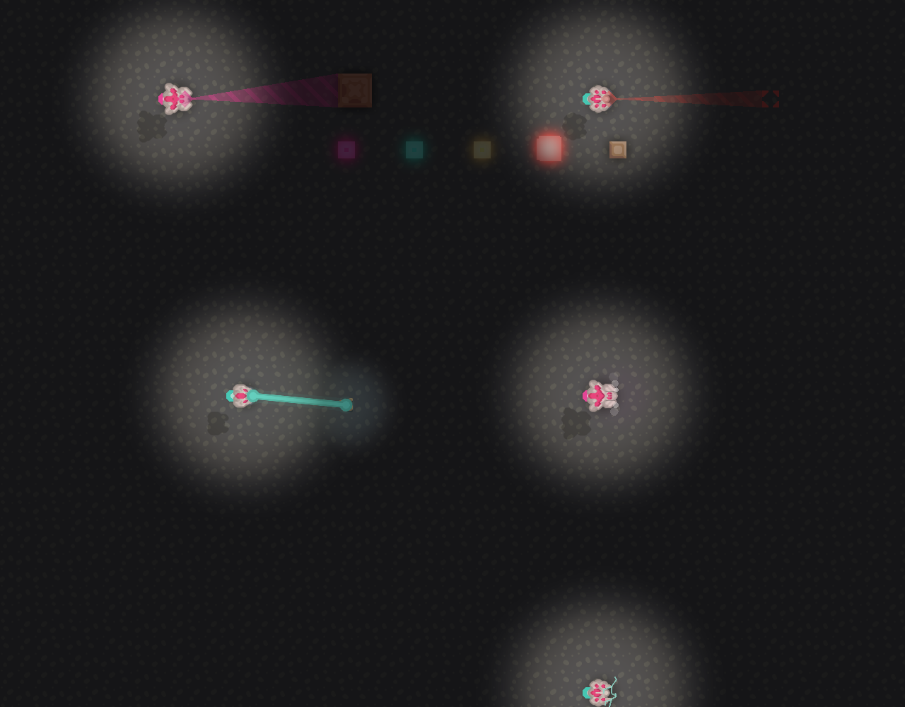
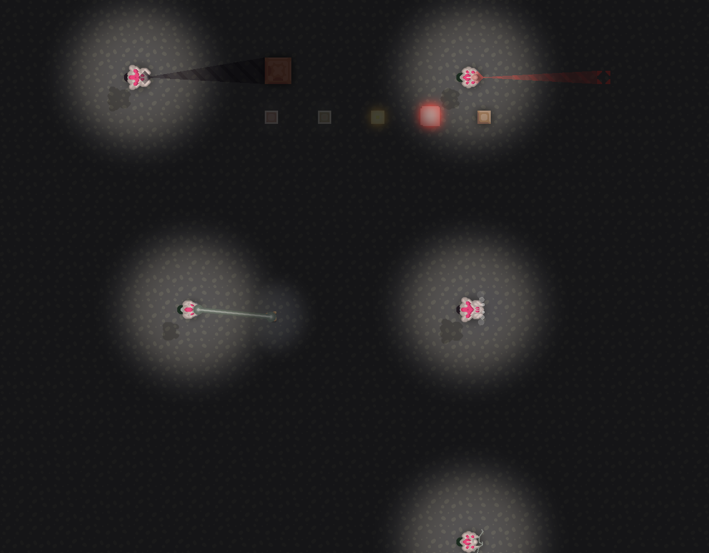

# Work effect colours — 0.32.19

The custom mining beam previously retained two vanilla tints: gold baked into minelaser/minelaser-end sprites, and the orange light automatically emitted by Drawf.laser. Private grayscale sprite copies now retain the exact alpha/geometry and shade contrast, while the explicit no-light laser overload is followed by one engine-coloured light at the selected laser opacity. Vanilla mining textures and default-colour ships are untouched.

For Serpulo ShipVariant builders with an explicit Engine colour, the native BlockBuildEndEvent selects the just-created, matching Fx.placeBlock EffectState and changes its renderer/colour in place. The replacement uses native 16-tick square geometry and timing. It adds no second effect or network packet, preserves visibility and disabled-effect behaviour, and leaves custom block placement effects, ordinary builders and deconstruction alone. Native constructFinish runs this local event on observing clients too; no new packet format is required. A live multiplayer comparison was not performed for this patch.

Validation: native 160.2 gameplay suite; real 160.7 desktop build/mining/demolition rendering; exact alpha/size and neutral RGB checks for both mining sprites; native default-orange control versus one custom engine-coloured mining light; real constructFinish for independent pink/cyan builders; exactly one effect per completion; native default flash, deconstruction and effects-disabled controls; unchanged shared block.placeEffect and Pal.accent. Test fixture: build/tooling/WorkColourDesktopCheck.java, log build/work-colours-03219-preview.log.

## 0.32.20 — pale accents on dark engine palettes

EngineHighlights derives cosmetic highlight colours with a modest extra white mix below 60% RGB brightness. Selected engine colours, hull/accent colours, engine flames, projectile base/hit colours, saved preferences and gameplay stats are unchanged. Bright palettes retain their existing highlight strength.

Mining keeps its engine-coloured outer beam, adds a thin pale core for dark palettes, and uses a precomputed per-ship light colour. It still emits exactly one light. Completion flashes retain the coloured outer square and add a narrow pale inner stroke. Decorative weapon lines, bursts, charge effects and existing missile/bolt centres use the same dark-colour adjustment; native muzzle flashes are brightened once at creation, while custom renderers derive their highlights without repainting old shots. No effect-per-particle colour copies or palette cache are introduced.

Validation: full native gameplay suite, including colour-copy/source immutability and bright-palette controls; real 160.7 near-black purple/green work rendering; original engine colours preserved; one mining light; independent completion colours and unchanged default/disabled/demolition behaviour. Fifteen dark-palette weapon/tier combinations exercise Vector, Superfactorial, Flux, Converge and Caustic through native firing/recoil. No new multiplayer session was run.

## 0.32.21 — release the completed beam target when switching build sites

The coloured beam cache previously changed only when activelyBuilding() returned true. Native build logic can retain buildAlpha near one while a remaining queued plan is out of range, preventing the cached completed target from fading. The cache now follows the current queued plan while updateBuilding is enabled, including out-of-range plans. Existing range checks suppress the beam there; pause and final completion still use native fading. No build queue, construction progress, range, opacity or gameplay state is changed by the fix.

Reproduced on the unpatched 0.32.20 desktop runtime: partially construct A, pause until its beam fades, move to a second site, build and finish B while A remains queued out of range. After 120 ticks, the old version still cached completed B. The same native sequence passes in 0.32.21: B's beam disappears, A remains unfinished and queued, moving back resumes A's beam, and finishing A clears/fades the beam. Full native 160.2 gameplay suite also passes. Fixture: build/tooling/BuildBeamSwitchCheck.java. Before/after logs: build/beam-switch-03220-before-preview.log and build/beam-switch-03221-after-preview.log.
